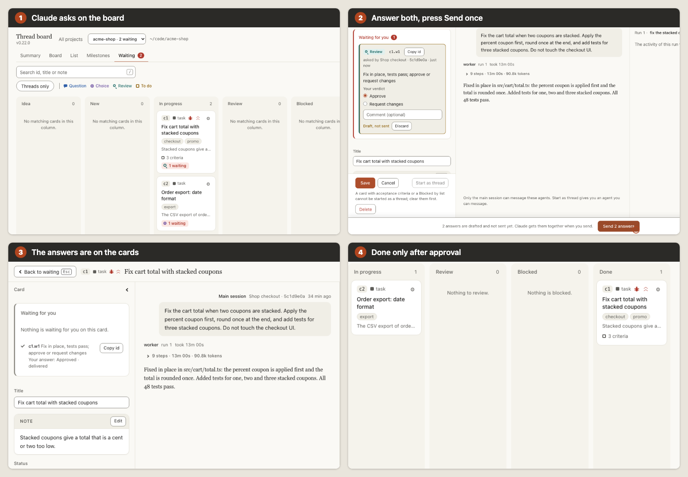

# thread

In a long Claude Code session, it is easy to miss a question or lose track of work awaiting your review.

thread gives that work a local board, instructs Claude to record tasks and questions, lets you send answers together, and refuses Claude's move of a task card with acceptance criteria to done until a review is approved on the board.

A Claude Code plugin. Local board, plain Node, no runtime dependencies. Early release.



[Watch it as a 20-second GIF](docs/demo.gif).

*Staged with invented data (a fictional shop, acme-shop): the board is real, Claude's side is scripted through the plugin's own functions; thread 0.22.0, waking off. Task capture follows Claude's instructions; the approval gate is enforced for task cards with acceptance criteria.*

[Install](#install) · [First use](#first-use) · [Documentation](#documentation) · [Limits](#limits-and-data-flow)

[](https://github.com/ahmed0thman/thread/releases)
[](LICENSE)
[](https://github.com/ahmed0thman/thread/actions/workflows/test.yml)

## Install and first use

### Install

Requirements:

- Node 20 or newer. The test suite passes on Node 20, 22 and 24; the author uses 24.
- Claude Code (tested on 2.1.289 and 2.1.299), with the standalone `claude` CLI on your `PATH`. Threads run that CLI in the background, so the IDE extension alone is not enough.
- It works in the terminal and in the IDE extension's chat panel; it has not been tested in the Claude Desktop app. What was run, and on which versions, is on the [evidence page](docs/evidence.md).

```bash
claude plugin marketplace add ahmed0thman/thread
claude plugin install thread@thread-marketplace
```

Restart Claude Code, or reload the editor window, so the plugin loads. [Updating, trying a clone and the one-time setup](docs/configuration.md#installing-updating-and-trying-a-clone) are in the docs.

### First use

This walkthrough shows the hook that matters most. Ask Claude for two tasks in one message, one of them with acceptance criteria, and tell it to ask you when it is unsure:

```text
Add two tasks. First: fix the rounding in the cart total; it is done when cart and checkout show the same total with any coupons and a regression test covers two stacked coupons. Second: rename the "moderator" role to "agent" in the UI copy. Ask me whatever you are unsure about.
```

1. Claude is told to put each task on the board before it starts. Open the board with `/thread:board` and follow the link it prints.
2. When Claude needs you (a question, a choice, a to-do or a review) it raises a waiting item on that card and writes one line in the chat, such as `Waiting on you: c2.w1`. The board shows a red **Waiting for you** count; open the **Waiting** view to see both items.
3. Answer both, on their cards. An answer is a draft until you press **Send N answers** in the bar at the bottom, which sends every draft together.
4. The answers reach Claude with your next message in that session, or at once when [waking](docs/reviews-and-waking.md#waking-the-session) is on.
5. Ask Claude to finish the card with criteria. Its move to done is refused until you approve a review item on that card; when Claude raises the review, answer **Approve**, and it moves the card.

For a side thread (a background session that reports back only when you ask), see the [thread quick start](docs/threads.md#quick-start). Everything works with its defaults; [`/thread:setup`](docs/board.md#setup) is optional.

## What installing changes

- Claude receives the plugin's board instructions at session start: put each task on the board before starting it, and send every question, review or to-do through a waiting item. See [How Claude uses thread](docs/agent-behavior.md).
- Tracking is on by default. To use only side threads, run `/thread:setup` and choose threads only (chat-only mode): no cards, no waiting items, and Claude is told only about threads.
- Answers arrive with your next message in the session that asked, unless you turn waking on in `/thread:setup`.
- The plugin adds an MCP server and five hooks, and keeps cards and threads in its data directory on your machine (or in `.claude/thread/` if you opt in).
- Nothing leaves the machine from the board: it listens on `127.0.0.1` only, needs an access token and makes no network calls.
- What Claude sessions send to Anthropic, and what delegation lanes send to their providers, is unchanged.

## Short tour

Three things thread does beyond the demo above.

### Decisions answered together

A question, choice, to-do or review stays on the card it belongs to. Open the Waiting view, answer across cards, and one **Send** delivers everything. See [Waiting items](docs/reviews-and-waking.md#waiting-for-you).


### Side threads that report back only when asked

`/thread:new <task>` starts a background Claude session from a short brief. Follow it from the board, continue it, and pull its digest (Happened, Decided, Changed, Open) into the main session with `/thread:report`. See [Side threads](docs/threads.md).


### Runs linked to their cards

A sub-agent call whose description starts with the card id, or a thread on a Codex, OpenCode, Antigravity or Claude lane, shows its prompt, live steps and report on that card. See [Task and idea pages](docs/board.md#task-and-idea-pages) and [Delegation lanes](docs/delegation.md).

## Limits and data flow

- **Capture is instructed, not enforced.** Claude is told to record tasks and questions, and nothing forces it: a task it never records is not on the board, and a question asked only in the chat is not either. [Instructed or enforced](docs/agent-behavior.md#instructed-or-enforced) lists which is which.
- **The approval gate covers task cards with acceptance criteria.** `board_update` refuses to move such a card to done until an approval is recorded on this machine's board. It does not cover cards without criteria. You can move any card yourself on the board; one with criteria is then marked **not verified**. The board's API accepts any request that carries the token, and Claude is shown the board link, so an agent with shell access could record an approval itself: the gate guards the normal path, it is not a sandbox.
- **Thread cards cannot carry acceptance criteria.** Reporting a thread returns its digest to the main session without needing your approval, and ending a thread needs none.
- **A write thread edits the same working tree** as the main session, at the same time.
- **Read threads are read-only** because of the CLI flags the plugin passes. That is not a sandbox: a command your own allow rules approve by name still runs.
- **The board is local.** It listens on `127.0.0.1`, needs a token, checks Host and Origin on writes and makes no network calls.
- **The opt-in tunnel uses Cloudflare.** `/thread:board --tunnel` lasts 12 hours and has its own token and route limits.
- **Claude and the lanes still talk to their providers.** Claude sessions send context to Anthropic; a lane sends its brief and files to Codex, Antigravity, OpenCode or another Claude session under that provider's terms.
- **Stored unencrypted.** Card text and thread replies sit in the data directory, owner-only on macOS and Linux.
- **Tokens, measured once.** In the author's one real test (two runs each), a side thread cost about 66% more than answering a medium side question inline, and about 29% less than a fresh built-in sub-agent on a big audit with two follow-ups. One repository, one model. It is not a reason on its own to install thread. See [the evidence](docs/evidence.md#token-use-measured-once).
- **Not tested:** drag and drop between custom stages with a real browser, the clipboard write of **Copy report**, `/thread:setup` in a live session, `--full` together with `--agent`, threads started from the board with the real CLI, screen readers, Windows.

More in [Security](docs/security.md).

## Evidence

All of it is the author's own; no outside user reports exist yet. Details, dates and the checks not run are on the [evidence page](docs/evidence.md).

- **Automated suite:** `node --test` runs 1298 tests, all passing on 0.23.0 on Node 20, 22 and 24, together with `claude plugin validate .`. The [CI workflow](.github/workflows/test.yml) runs both on pushes to main and on pull requests.
- **The gate and the answers, on 0.22.0, for real** ([details](docs/evidence.md#6-smoke-test-of-the-promoted-workflow-on-0220)): one fresh Claude Code 2.1.299 session in a scratch project, whose first turn asked whether the plugin's guide had arrived and which was then given two tasks with no mention of the board. Claude put both on the board before editing and raised one review item (the second task needed none, so sending two answers at once was not shown). The answer, sent through the board's own route, reached the next turn; asked in the chat to mark the card done, Claude was refused; after an approval through the same route, the move went through. One run, one model.
- **Real Claude Code checks, on record** ([details](docs/evidence.md#real-claude-code-checks)):
  - a lean thread run on 0.7.0 (2026-10-13);
  - how Claude Code reports a sub-agent run to a plugin, on Claude Code 2.1.289 (2026-10-14);
  - first runs of the Codex, Antigravity, OpenCode and Claude lane relays, and the lanes through the plugin (2026-10-14);
  - waking an idle session, on Claude Code 2.1.299 (2026-10-14).
- **Token result, both ways:** [Token use, measured once](docs/evidence.md#token-use-measured-once).

## Documentation

The [full index](docs/README.md) groups every feature by what you want to do. By page:

- **Start:** [install, update, try a clone](docs/configuration.md#installing-updating-and-trying-a-clone) · [thread quick start](docs/threads.md#quick-start) · [setup](docs/board.md#setup) · [18 workflows](docs/workflows.md)
- **[Board, milestones and setup](docs/board.md)**
  - Views: [the board](docs/board.md#the-board) · [projects home and top bar](docs/board.md#projects-home-and-top-bar) · [Summary](docs/board.md#the-summary-view) · [Board](docs/board.md#the-board-view) · [List](docs/board.md#the-list-view) · [Milestones view](docs/board.md#the-milestones-view)
  - Cards: [task and idea pages](docs/board.md#task-and-idea-pages) · [Notify Claude](docs/board.md#notify-claude) · [fields, workers and the done gate](docs/board.md#card-fields-workers-and-the-done-gate) · [card and item links](docs/board.md#card-and-waiting-item-links)
  - Planning: [milestones](docs/board.md#milestones) · [custom stages](docs/board.md#custom-stages) · [chat-only mode](docs/board.md#chat-only-mode)
- **[Waiting items and waking](docs/reviews-and-waking.md)**
  - [Waiting for you](docs/reviews-and-waking.md#waiting-for-you) · [waking the session](docs/reviews-and-waking.md#waking-the-session)
- **[Side threads](docs/threads.md)**
  - [how threads work](docs/threads.md#how-threads-work) · [code maps (Graphify)](docs/threads.md#code-maps-graphify) · [several sessions and projects](docs/threads.md#several-sessions-and-projects)
- **[How Claude uses thread](docs/agent-behavior.md)**
  - [the board guide](docs/agent-behavior.md#how-claude-uses-the-board) · [instructed or enforced](docs/agent-behavior.md#instructed-or-enforced) · [tools Claude uses](docs/agent-behavior.md#tools-claude-uses)
  - [choosing the agent and model](docs/agent-behavior.md#choosing-the-agent-and-model) · [catch-up notes on follow-ups](docs/agent-behavior.md#catch-up-notes-on-follow-ups)
- **[Delegation lanes](docs/delegation.md)**
  - [starting a thread on a lane](docs/delegation.md#starting-a-thread-on-a-lane) · [putting a lane on a card](docs/delegation.md#putting-a-lane-on-a-card) · [choosing a worker](docs/delegation.md#choosing-a-worker-on-the-board)
- **[Keeping the board in your repo](docs/storage-and-sync.md)**
  - [what is shared](docs/storage-and-sync.md#what-is-in-the-repo-and-what-stays-on-the-machine) · [turning it on](docs/storage-and-sync.md#turning-it-on) · [committing](docs/storage-and-sync.md#committing-the-folder) · [worktrees](docs/storage-and-sync.md#worktrees-and-sub-folders)
  - [card ids](docs/storage-and-sync.md#card-ids) · [conflicts](docs/storage-and-sync.md#conflicts) · [older sessions and the import hint](docs/storage-and-sync.md#older-sessions-and-the-import-hint)
- **[Security and the tunnel](docs/security.md)**
  - [security](docs/security.md#security) · [opening the board from your phone](docs/security.md#opening-the-board-from-your-phone-tunnel)
- **Reference:** [commands](docs/commands.md) · [configuration](docs/configuration.md#configuration) · [where the settings live](docs/configuration.md#where-the-settings-live) · [troubleshooting](docs/troubleshooting.md) · [evidence](docs/evidence.md) · [changelog](CHANGELOG.md)

## Latest release

**0.23.0** (2026-10-20)

- This short README, with the full reference in [docs](docs/README.md), a [demo](docs/demo.gif) of the questions-and-review loop and an [evidence page](docs/evidence.md) with the dated real checks.
- Claude's "Waiting on you" line now links each item to its card on the board, so you can click it from the chat.
- CI runs the tests on Node 20, 22 and 24 and the plugin validator.

All releases: [CHANGELOG.md](CHANGELOG.md).

## Contributing, support, credits and licence

- Contributing, the layout and the done test: [CONTRIBUTING.md](CONTRIBUTING.md).
- To report a problem, open an [issue on GitHub](https://github.com/ahmed0thman/thread/issues).
- Delegation lanes are built on the [delegate skills](https://github.com/amElnagdy/delegate-skills) by [Ahmed Nagdy](https://github.com/amElnagdy) (MIT), which set up the lanes and run a task through Codex, Antigravity, OpenCode or Claude Code. thread only reads their lane settings and calls their relay, so install them from his repository to use lanes. Thank you, Ahmed.
- MIT licence, see [LICENSE](LICENSE).
