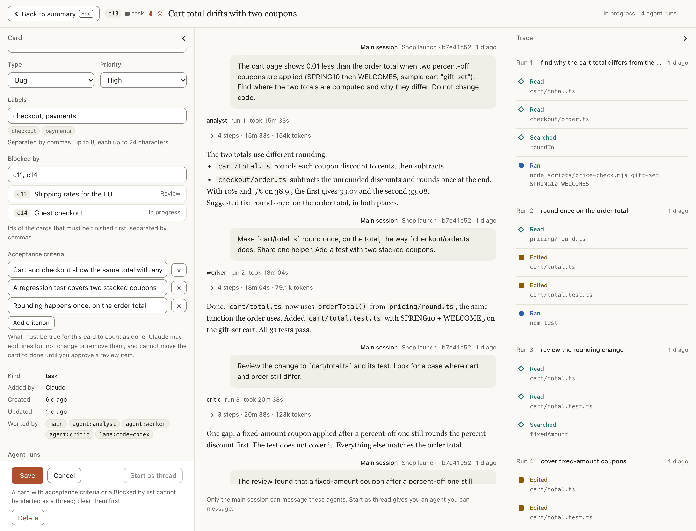
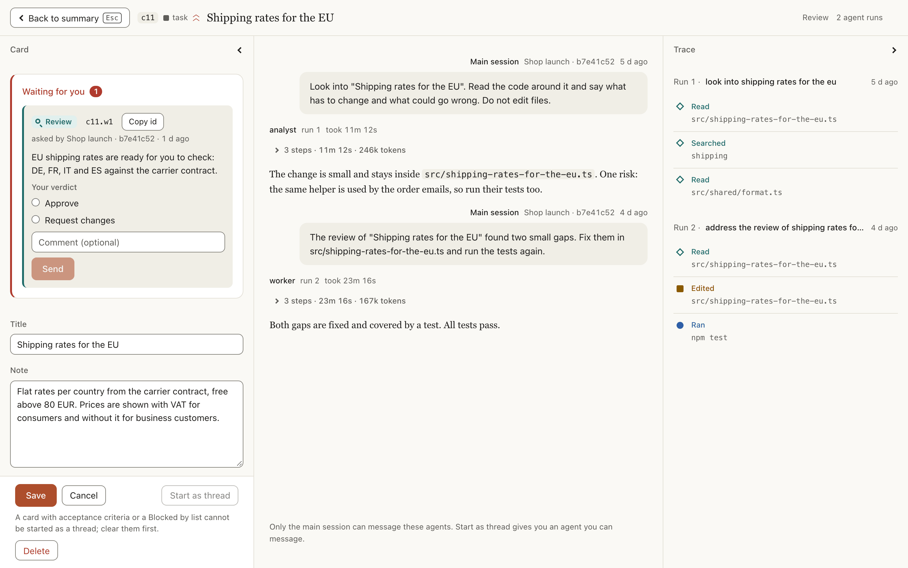
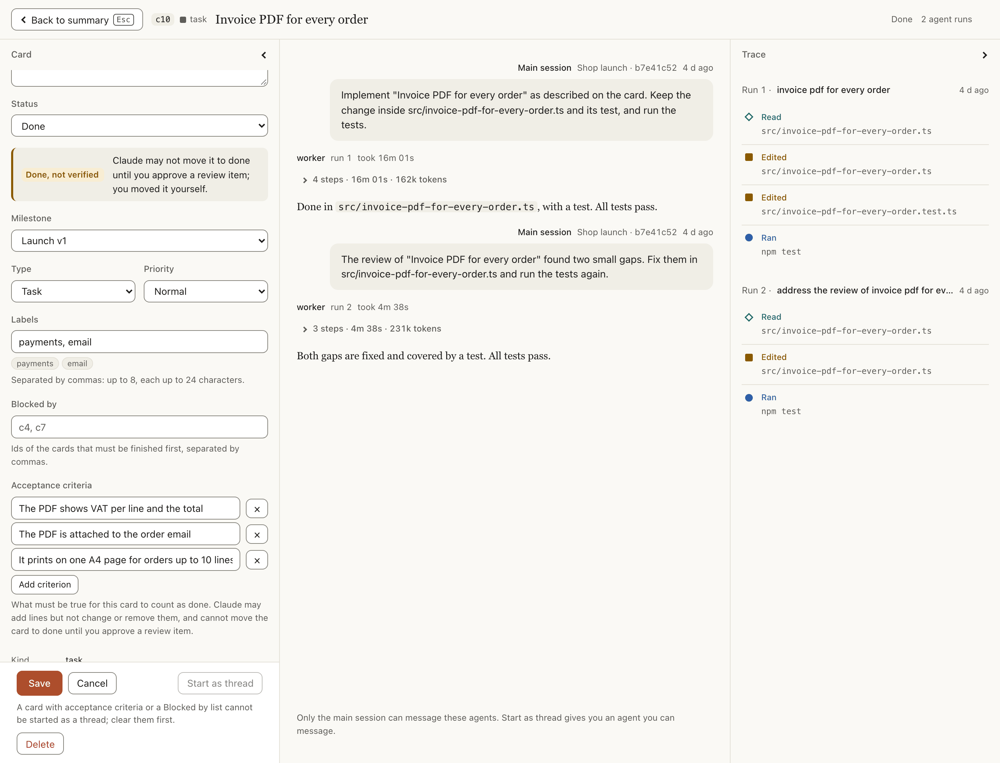
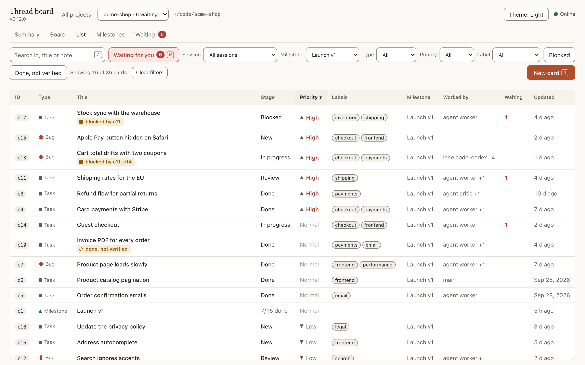
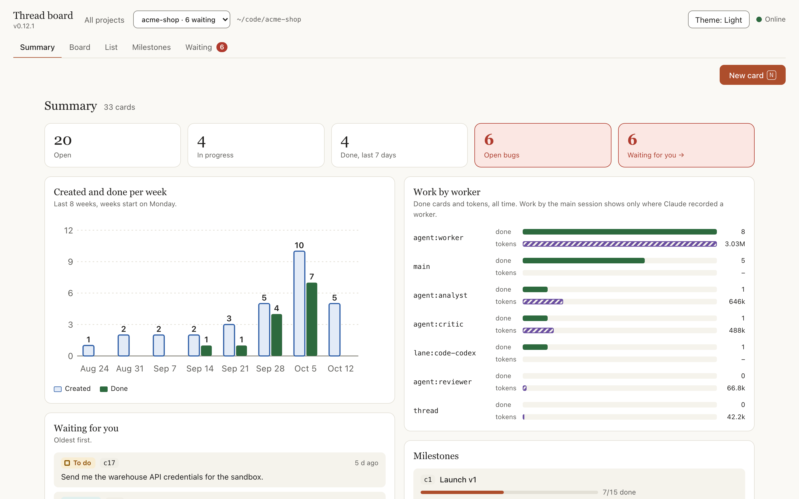
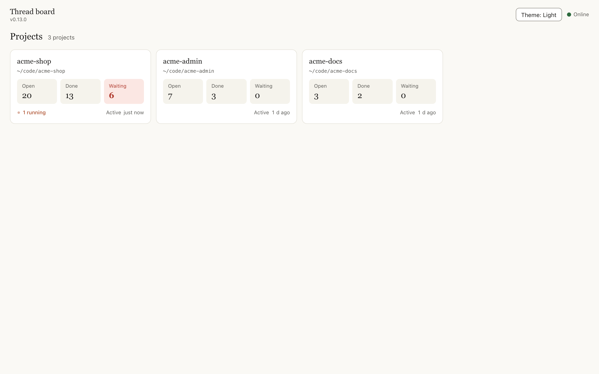
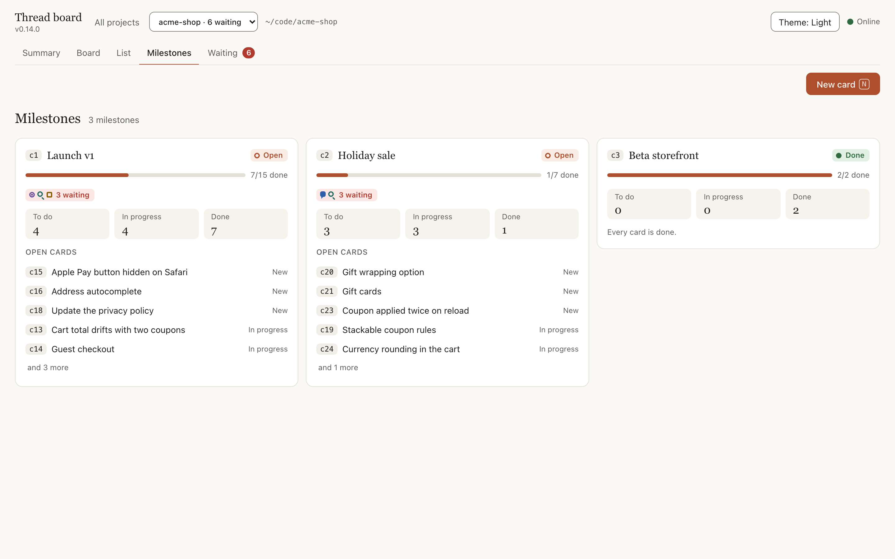
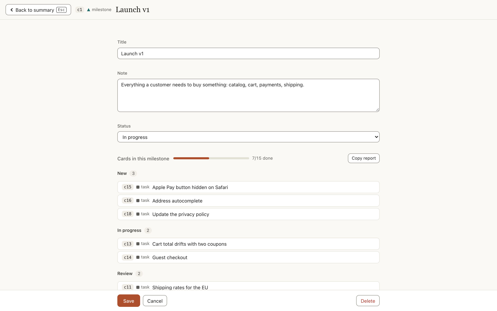

# Workflows

Part of the thread documentation: [index](README.md).

Eighteen worked examples, each with the commands or clicks it takes. Every screenshot shows an invented shop, `acme-shop`.

## 1. A side question that needs real work

You are halfway through a refactor and wonder whether a library you depend on has a known problem. Asking in the main session would interrupt the refactor and fill its context with search results.

```text
/thread:new find out whether pg-boss has open issues about jobs being lost on failover, and whether Graphile Worker handles that case better. Cite what you find.
```

The thread can search the web and read the project. The main session keeps refactoring. When the thread finishes:

```text
/thread:report c7
```

```text
## Happened
- Read the pg-boss and Graphile Worker issue trackers and both projects' docs on failover.
- Found two open pg-boss issues describing jobs left in "active" after a primary failover.

## Decided
- Graphile Worker's locking makes the lost-job case less likely, but neither tool removes the need for idempotent jobs.

## Changed
- Nothing; this thread was read-only.

## Open
- Neither project documents behaviour under a network partition. Worth a test before choosing.
```

Only this digest enters the main session, not the pages the thread read.

## 2. A second opinion on the plan you are in the middle of

Claude puts the plan's decisions and the file paths into the thread's brief, so you do not have to explain the plan again. If the plan is spread over a long conversation and a brief would lose too much, add `--full` to give the thread the whole session.

```text
/thread:new review the migration plan we just agreed. Look for steps that cannot be rolled back and for anything that assumes the old column still exists. Be critical.
/thread:new --full review the migration plan, including the options we rejected earlier
```

Carry on implementing. Report when the thread is done, or read it on the board first and decide whether the main session needs to hear it at all.

## 3. Investigating something unrelated while work continues

A failing test catches your eye, but it is not what you are working on.

```text
/thread:new the test "sync resumes after a dropped connection" fails about one run in five. Find out why. Do not fix it; tell me the cause and the smallest fix.
```

The thread reads and runs what your permission rules already allow. Later you can ask it for more without restarting:

```text
/thread:continue c9 does the same race exist in the upload path?
```

A follow-up keeps the thread's own history, so it builds on what it already found. If something changed in the main session since the thread's last turn, Claude opens the message with a short catch-up (see [Catch-up notes on follow-ups](agent-behavior.md#catch-up-notes-on-follow-ups)).

## 4. Parking instructions and ideas without interrupting

Mid-task you remember two things. Neither should replace what Claude is doing.

```text
/thread:add rename the "moderator" role to "agent" across the app once this ships
/thread:add idea: let users snooze a conversation until a set time
```

Each becomes a card on the board. Claude confirms in a line and returns to its work. You can also add cards on the board page itself; Claude is told about them on your next message and picks them up at a natural stopping point.

During longer work Claude uses the board on its own to keep track of instructions you give or change along the way. It moves cards between the board's stages as the work changes: by default In progress, Review, Blocked and Done. This is the `/thread:track` skill, which Claude loads itself. In [chat-only mode](board.md#chat-only-mode) Claude cannot add cards.

## 5. Handing a contained change to a thread

Threads are read-only unless you say otherwise. When you explicitly ask a thread to change files, it runs in write mode:

```text
/thread:new --write add unit tests for parseHandback covering a reply with no headings and a broken step map. Do not touch other files.
```

A write-mode thread edits the same working tree as the main session, at the same time. Give it work that does not overlap with what the main session is editing, and review its changes like any others.

## 6. Comparing with another repository or folder

A thread can read the project. To let it read somewhere else, name the folder in the task and Claude grants the thread that folder only:

```text
/thread:new compare our webhook handler with the one in /Users/me/code/billing-service and list what theirs validates that ours does not
```

## 7. Talking to a thread from the board

Open the board with `/thread:board`, choose **Board** in the top bar and click a thread card (a row in the **List** opens it too). The thread opens full-window: its conversation in the centre with a message box, its ids, digest and decisions on the left, and a step-by-step trace on the right. Type a follow-up there and the thread runs another turn. While a turn runs, the conversation shows what the thread is doing as it happens: its messages and each tool it uses. This is the way to read or continue a thread without putting anything into the main session.

A task or idea card can become a thread from there too. Open the card, press **Start as thread**, and choose the session it reports to, a [**Worker**](delegation.md#choosing-a-worker-on-the-board) (Claude, one of your sub-agents or a delegation lane), and Brief or Full copy. When it has finished, **Report to main session** queues its digest for your next message in that session (or wakes the session within a few seconds, with [waking](reviews-and-waking.md#waking-the-session) turned on).

## 8. Several sessions in one project

You have two Claude sessions open in the same project. Session A started thread `c3`. In session B you type `/thread:report c3` by mistake.

Nothing is reported. Claude Code's question popup appears, headed "Wrong session", naming the session that started the thread and the one you are in, with **Cancel (Recommended)** and **Report here**. The digest is handed over only if you choose to report there.

## 9. Briefs and models: what a thread starts with

A thread pays for its context again on every step it takes, so what it starts with matters more than what it writes. The default is a brief, not a copy of your conversation: you type what you need, and Claude writes the thread the goal, the decisions and constraints that apply, the file paths and what was already ruled out.

```text
/thread:new check that every handoff trigger in section 12 of the plan has a test
```

A brief thread sends far less context than a full copy. In one long session of the author's, threads that were full copies re-read 1.35 to 2.86 million input tokens each, and a brief thread in the same project used about 91 thousand for a small task. That does not make a thread cheaper than the alternatives. In the author's one real cost test (two runs each), a side thread cost about 66% more than answering a medium side question inline, and about 29% less than a fresh built-in sub-agent on a big audit with two follow-ups; the scope and caveats are in [Evidence](evidence.md#token-use-measured-once). Use a thread for a cleaner main session and for follow-ups that resume its own history; for small work, answering inline costs less.

Routine work does not need the main session's model, and you do not have to say so. Claude is already writing the brief, so it also chooses what runs the thread without another model call: a sub-agent of yours whose description fits, else `haiku` or `sonnet`, else the session's own model. It tells you what it chose, for example "c7 is running as `worker-high`, the cheapest agent whose description covers reading and listing files". To decide yourself, name the agent or the model:

```text
/thread:new --agent haiku-coder list every file that still mentions the old env variable API_HOST
/thread:new --model opus --effort high review the retry logic for double charges
```

Use `--full` only when a brief would lose too much, for example a judgment that depends on a long discussion:

```text
/thread:new --full which of the options we rejected today should we reconsider, and why
```

Each thread's token use is shown on its card and in `/thread:status`, so you can see what a thread cost. The full rules, including when Claude deliberately keeps the session's own model, are in [Choosing the agent and model](agent-behavior.md#choosing-the-agent-and-model).

## 10. Grouping a piece of work under a milestone

You are building an invoice export. It will take a few tasks, an idea you do not want to lose, and one investigation. Make a milestone first, then put everything under it.

```text
/thread:add --milestone Ship the invoice export
```

Claude answers with the new card's id, say `c12`. Then:

```text
/thread:add --parent c12 write the CSV exporter
/thread:add --parent c12 idea: offer an Excel export too
/thread:new --parent c12 check how the export behaves with 100,000 rows
```

Later, `/thread:board --parent c12` prints the report for the milestone: its state (open or done), how many of its cards are done, and every card under it grouped by stage. See [Milestones](board.md#milestones) for the details.

## 11. Setting the plugin up for how you work

Your team does not use "Idea, New, In progress, Review, Blocked, Done". You use To do, Doing, Check and Done.

```text
/thread:setup
```

Claude asks whether the setting is for every project or this one, whether you want threads only or threads plus the task board, for the task board how you work, whether the board may wake an idle session, and whether new threads should use a project's Graphify code map. You describe it in your own words ("I write a task, start it, someone reviews it, then it's finished"). Claude proposes the stages and says which one each part of the plugin will use ("a running thread sits in Doing"). You change the list until you agree, and Claude saves it. See [Setup](board.md#setup) and [Custom stages](board.md#custom-stages).

## 12. Threads only, no task board

You only want side threads and have no use for cards, ideas or milestones. Run `/thread:setup` and choose threads only. Claude stops creating cards, the board page shows only threads, and `/thread:add` is refused with a message that says how to turn the task board back on. See [Chat-only mode](board.md#chat-only-mode).

## 13. Tracking AI work end to end: acceptance criteria and the done gate

You want a bug fixed, and you want to be the one who says it is fixed. Add the card with its fields from the command: with `/thread:add` a bug, a priority, labels and acceptance criteria are flags. Or tell Claude in plain words and it sets the same fields.

```text
/thread:add --bug --priority high --label checkout --label payments --criteria "the cart and checkout show the same total with any coupons" --criteria "a regression test covers two stacked coupons" --criteria "rounding happens once, on the order total" the cart total is 0.01 lower than the order total when two percent-off coupons are applied
```

The same card, in plain words:

```text
Add a bug: the cart total is 0.01 lower than the order total when two percent-off coupons are applied. High priority, labels checkout and payments. It is done when the cart and checkout show the same total with any coupons, a regression test covers two stacked coupons, and rounding happens once, on the order total.
```

Either way the card is added with `board_add` (type `bug`, priority `high`, the labels and three `criteria`) and replies with its id, say `c13`. Claude then hands the work to sub-agents, starting each Agent call's description with `[c13]` so the runs show on the card, and passing `worker` so the card lists who did what. Open the card on the board: the bug and priority are in the header, the fields on the left, **Worked by** under them, each run in the centre with its prompt, steps and report, and the trace on the right.



When the work is finished, Claude is instructed not to move the card to done itself (and the tool refuses if it tries). It raises a review item with `wait_add` and tells you in one line, such as `Waiting on you: c13.w1`. The card gets a red **waiting** tag and the project's Waiting view gets a count. Open the card, read the review, and answer **Approve** or **Request changes** (with a comment); that makes a draft, and **Send** in the bar at the bottom sends it, together with any other drafts. This is what a review looks like, here on another card, c11:



Your answer reaches Claude with your next message in that session. After **Approve**, Claude moves the card to done with `board_update`. If it tried before, the tool refused: a card with criteria cannot go to done until you approve a review. After **Request changes**, Claude carries on with your comment, and the card still needs an approved review before Claude can move it to done. See [Waiting for you](reviews-and-waking.md#waiting-for-you) and [Card fields, workers and the done gate](board.md#card-fields-workers-and-the-done-gate).

## 14. Seeing that a card was closed without your approval

The gate holds Claude, not you. You are in a hurry and drag a card that has acceptance criteria to **Done** (or a stage after it, such as Released) yourself, from the Board, from **Move to** in its gear menu, or with the Status select on its page. It moves, and from then on it says so everywhere:

- on the Board its face has a red **not verified** tag;
- in the List, `done, not verified` sits under its title, and the **Done, not verified** button shows only such cards;
- on its page, a **Done, not verified** note says that Claude may not move it to done or a later stage until you approve a review item, and that you moved it yourself;
- in `/thread:board`, the line has `(done, not verified)`.



To check it properly, ask Claude to review the card and raise a review item on it. When you answer **Approve**, the mark goes away. Moving the card out of the finished stages (Done and every stage after it) and back takes the approval away again; moving it from Done to a later stage such as Released does not.

## 15. Triaging bugs and priorities in the List

You have 36 cards and want to know which bugs to look at first. Open the board with `/thread:board`, then **List** in the top bar. Click the **Priority** header to put High first, set **Type** to Bug, or pick a **Label** such as `payments`. The **Blocked** button leaves only the cards that wait for something that is not done yet, and a line beside the toolbar says how many cards match, with **Clear filters**.



A blocked card says `blocked by c11, c14` under its title, and the **Worked by** column shows who worked on it. Click a row, or focus it and press Enter, to open the card; `Esc` returns to the List with your filters as you left them. The screenshot is filtered by milestone, not by type. The columns, sorting and filters are in [The List view](board.md#the-list-view).

## 16. A Monday look at a project

At the start of the week you want to know where a project stands without reading every card. Open the board with `/thread:board`; the project opens on its **Summary**.



Read it from the top: the tiles (open cards, cards in progress, cards done in the last 7 days, open bugs), the line chart of cards created, done and still open (is the backlog growing?), **Work by worker** with done counts and tokens, **Waiting for you** (click an item to answer on its card) and the milestones. The filter bar narrows every number to one milestone, worker, type, priority or label, and **About these numbers** at the bottom says what the figures cannot know. See [The Summary view](board.md#the-summary-view).

## 17. Many projects at once

You work in several repositories, each with its own board, and want to know which one needs you. Open any board link, then **All projects**, or go to the address with no project (`#/`).



Each tile shows the project's open and done cards, the items waiting for you (in red when there are some) and the threads that are running. Here `acme-shop` has 6 items waiting and one thread running, so you start there. Inside a project, the select next to **All projects** moves you to another one and reads `acme-shop · 6 waiting` for a project with something waiting. See [Projects home and top bar](board.md#projects-home-and-top-bar) and [Several sessions and projects](threads.md#several-sessions-and-projects).

## 18. Planning a release with milestones and blockers

You are shipping a first version. Make a milestone and put the work under it (Claude answers with the milestone's id, here `c1`):

```text
/thread:add --milestone Launch v1
/thread:add --parent c1 guest checkout
/thread:add --parent c1 shipping rates for the EU
```

Say which card has to wait for which: "c13 is blocked by c11 and c14". Claude sets `blocked_by` with `board_update`. You can do the same on the card's page, in the **Blocked by** field, with ids separated by commas. While c11 or c14 is not in the Done stage or a later one (such as Released), c13 carries a red **blocked** tag on the Board and `blocked by c11, c14` in the List, naming only the blockers still open. A blocker is a mark, not a lock: nothing stops you or Claude moving the card, and the one thing it does stop is **Start as thread** on that card.

Check progress in the **Milestones** view: a map of the milestones in number order, joined wherever a card in one milestone is blocked by a card in another, so you see which milestone waits for which and what is ready now. A milestone has no stage of its own: it is open until every card in it is done.



Click a milestone's title to open its page, with the cards grouped by stage and **Copy report** for a plain-text version to paste into a message. `/thread:board --parent c1` prints the same report in the chat.



See [Milestones](board.md#milestones) and [Card fields, workers and the done gate](board.md#card-fields-workers-and-the-done-gate).
